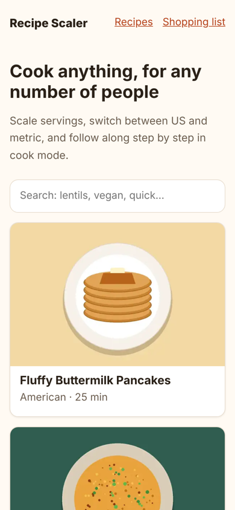
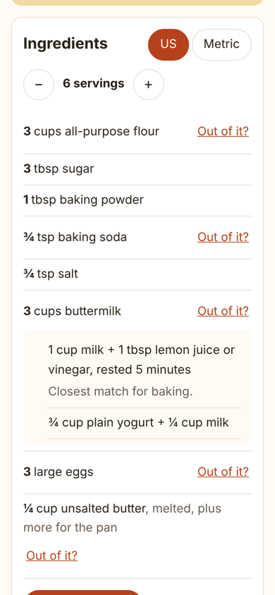
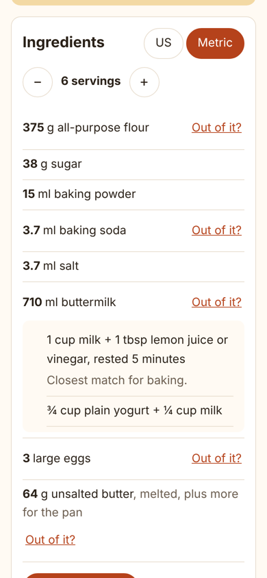
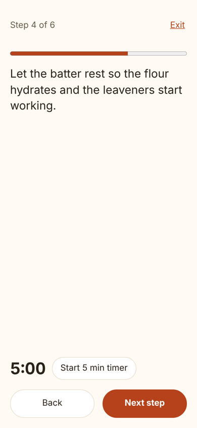
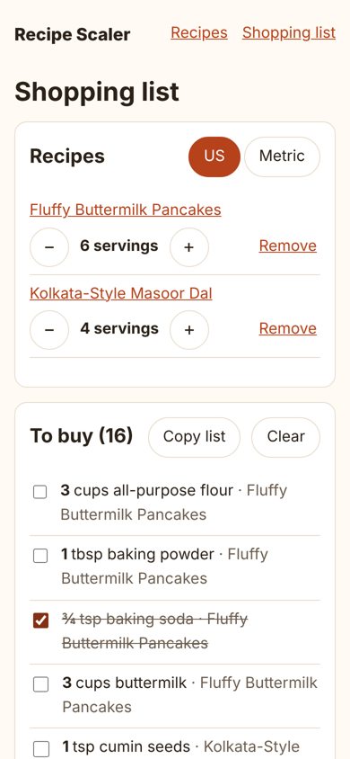

# Recipe Scaler

[](https://github.com/Abhirup-code/Recipe_Scaler/actions/workflows/ci.yml)
[](LICENSE)

**Live demo: https://abhirup-code.github.io/Recipe_Scaler/**

A mobile-first recipe site that makes home cooking easier: scale any recipe to the number of people you are feeding, switch between US and metric, follow along in a step-by-step cook mode that keeps your screen on and works hands-free by voice, find a substitute when you are out of an ingredient, and turn several recipes into one shopping list.

Built with **Next.js, React, and TypeScript**, tested with **Vitest and React Testing Library**, and checked by **Lighthouse** on every pull request.

<p>
  
  
  
  
  
</p>

## Features

| Feature | How it works |
|---|---|
| **Serving-size scaling** | Every amount updates as you change servings and stays readable: 1.5 cups shows as "1½ cups", and 3 tsp rolls up into "1 tbsp". |
| **Scale to what you have** | Only have 300 g of lentils or 3 eggs? Pick the ingredient, enter what you have (in any matching unit, or by weight for flour, sugar, and lentils measured in cups), and the whole recipe rescales around it, showing about how many servings it makes. |
| **US and metric** | One tap converts the whole recipe. Flour, sugar, and butter switch to grams (using each ingredient's density), not just millilitres. Your choice is remembered. |
| **Cook mode** | One large step at a time with big Back and Next buttons (or arrow keys), built-in timers on timed steps, and the [Screen Wake Lock API](https://developer.mozilla.org/docs/Web/API/Screen_Wake_Lock_API) so the phone does not go dark mid-recipe. |
| **Hands-free voice control** | Messy hands? Turn on Hands-free in cook mode and say "next", "back", "repeat" (reads the step aloud), "start timer", "pause timer", or "exit". Uses the browser's built-in [Web Speech API](https://developer.mozilla.org/docs/Web/API/Web_Speech_API), so there is no API key, no cost, and no voice data stored by the site. Ignores its own voice while reading a step, keeps listening through pauses, and explains clearly if the microphone is blocked. Hidden in browsers without speech recognition. |
| **What can I cook?** | A Pantry page where you tick what is in your kitchen (sizes ignored, so "small onion" and "large onion" are both just onion; salt, pepper, and water assumed). Recipes you can make right now come first, then the ones you are closest to, with exactly what is missing. Your pantry is remembered, and the shopping list moves things you already have into a separate "Already in your kitchen" section that is left out when you copy the list. |
| **"Out of it?" substitutions** | Suggested swaps for common ingredients (buttermilk, eggs, butter, soy sauce, ...), with notes on what changes in the dish. |
| **Shopping list** | Add recipes at any serving size. Matching ingredients are combined even when recipes use different units (2 tbsp + 1 cup of milk), and you can check items off or copy the list. |
| **Search** | Filter by name, cuisine, tag, or ingredient ("lentils", "vegan quick"). |
| **Saved recipes** | Tap ♡ Save on any recipe to keep it on a Saved page, newest first. |
| **Works offline** | Installable on a phone's home screen. A service worker keeps every recipe you have opened available without internet, and shows a friendly page for ones you have not. |
| **Print** | A clean, ink-friendly printout of the ingredients and steps, without buttons or menus. |
| **Analytics and an A/B test** | Optional Google Analytics 4 events (cook mode started and finished, voice commands, servings and units changed, saves, prints, list adds) plus an A/B test of the cook-mode button label. Off unless a GA4 ID is configured, and never on for visitors with Do Not Track or Global Privacy Control. |
| **SEO** | Every recipe page is pre-rendered HTML with [schema.org Recipe](https://developers.google.com/search/docs/appearance/structured-data/recipe) structured data, canonical URLs, Open Graph tags, a sitemap, and robots.txt. |

## Quality

| Check | Result |
|---|---|
| Lighthouse (home page, mobile) | Performance 100, Accessibility 100, Best Practices 100, SEO 100 |
| Lighthouse (recipe page, mobile) | Performance 99, Accessibility 100, Best Practices 100, SEO 100 |
| Core Web Vitals (lab) | LCP 1.2 to 1.7 s, CLS 0 |
| Unit and component tests | 166 tests (Vitest, React Testing Library), 99% line coverage, 90% coverage gate in CI |
| End-to-end tests | 22 Playwright tests in a mobile browser: the full cooking flow, hands-free voice control, scaling to what you have, the pantry, saved recipes, shopping list, print view, offline caching, and install manifest |
| Accessibility | axe-core scans of every page, of cook mode, voice mode, the scaling form, and a filled pantry in light and dark themes find no WCAG 2.1 AA violations; any new violation fails CI |

CI fails a pull request if Lighthouse drops below 90 for performance or 95 for accessibility, best practices, or SEO, or if layout shift goes above 0.1.

## Design decisions

- **Static site, no server.** Every page is generated at build time (`output: "export"`), so the site is fast, cheap to host on GitHub Pages, and fully readable by search engines.
- **Pure, tested logic.** Unit conversion, fraction formatting, scaling, list merging, and structured data are plain TypeScript functions in `src/lib` with their own tests; components stay thin.
- **Saved preferences without hydration bugs.** The unit choice and shopping list live in `localStorage` behind a small store used with React's `useSyncExternalStore`. Server and first render agree, saved values appear right after, and open tabs stay in sync.
- **Safe structured data.** JSON-LD is serialized with `<` escaped, so recipe text can never close the script tag and inject code.
- **Ready for AI substitutions.** Substitutions come from a `SubstitutionProvider` interface. Today it reads a curated list; an LLM-backed provider (behind a server route that keeps the API key secret) can be added without changing the UI.
- **Voice commands as a pure function.** `parseCommand` turns whatever the recognizer heard into one of six commands with whole-word matching ("background music" is not "back"), so it is tested on its own. The browser recognizer is replaced with a fake in both unit and Playwright tests, so CI can "speak" to the app without a microphone.
- **A/B test that survives hydration.** Each visitor keeps one variant forever. The end-to-end tests caught a bug where React's first render (with no saved value yet) re-randomized returning visitors; the fix reads the saved value directly, and a regression test renders on the "server" and hydrates to prove it.
- **Privacy-first analytics.** Nothing loads without a GA4 ID, Do Not Track and Global Privacy Control are respected, and tracking calls can never break the page.
- **Accessible by default.** Semantic HTML, labelled controls, 44 px tap targets, visible focus, a skip link, screen-reader announcements for results and timers, dark mode, and reduced-motion support.

## Tech stack

Next.js 16 (App Router, static export), React 19, TypeScript (strict), CSS with custom properties, service worker (PWA), Google Analytics 4, Vitest, React Testing Library, Playwright, axe-core, ESLint, Lighthouse CI, GitHub Actions, GitHub Pages, Dependabot.

## Run locally

Requires Node.js 22.

```bash
npm ci
npm run dev            # http://localhost:3000
npm test               # unit and component tests
npm run lint && npm run typecheck
npm run build          # static site in ./out
npx playwright install chromium && npm run test:e2e   # browser tests against ./out
```

To turn on analytics, create a free Google Analytics 4 property and build with `NEXT_PUBLIC_GA_ID=G-XXXXXXXXXX` (in GitHub Actions, add it as a repository variable and pass it to the build step).

## Project structure

```
src/
  app/          pages: home, recipes, saved, shopping list, offline, sitemap, robots, manifest
  components/   interactive pieces: scaling panel, cook mode, timers, saving, shopping list
  data/         the recipes
  lib/          tested logic: units, formatting, scaling, shopping list, schema, storage,
                analytics, A/B test
public/sw.js    service worker for offline use
tests/          unit and component tests
e2e/            Playwright end-to-end and accessibility tests
```


## License

[Apache License 2.0](LICENSE). Recipes and illustrations are original to this project.
